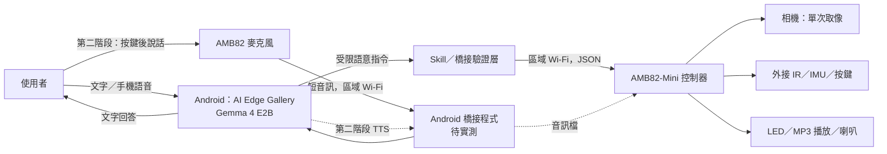

# 星伴水獺 Star Otter：AMB82-Mini × Gemma 4 E2B 智能陪伴絨毛寵物

> 課程專題提案，2026-10-31。本文為設計與驗收規劃；成品圖為 AI 合成概念圖，並非已完成的實物。

## 1. 專題構想

「星伴水獺」是一隻會用短語音、燈光與簡單動作回應的桌上型絨毛寵物。使用者可以從 Android 手機上的 Google AI Edge Gallery 與 Gemma 4 E2B 對話，也可以在第二階段按下玩具上的按鍵，直接對玩具說話。它的特色是「抱起來開始一段故事」：外接 IMU 偵測拿起事件，手機上的模型接續上次選的故事主題，玩具以燈光和語音回應。無手機連線時，仍能播放預先存放在 microSD 的固定問候與故事片段。

專題聚焦在陪伴和故事互動，不宣稱能診斷情緒、提供心理治療，也不做自主移動。AMB82-Mini 負責感測、音訊播放、燈光和安全限制；Gemma 4 E2B 在 Android 裝置上做語意理解及文字回覆。Gemma 4 E2B 的官方定位是手機端文字、影像、音訊輸入到**文字輸出**，因此說話還要另接 TTS 或播放預錄 MP3。[Gemma 4 模型資料](https://ai.google.dev/gemma/docs/core/model_card_4)

## 2. 四種互動組合比較

| 作品與互動入口 | 使用情境 | 優點 | 實作難點與限制 | 建議 |
|---|---|---|---|---|
| **雙輪 RoboCar＋手機 App** | 使用者在 App 輸入「往前走一小段，看到障礙就停」 | 畫面可顯示相機與狀態，容易檢查模型提出的動作；手機提供運算 | Wi-Fi 延遲不可用於即時避障；要由 AMB82 本地限制速度、距離與停車 | RoboCar 的第一版首選 |
| **雙輪 RoboCar＋直接說話** | 對車子說「跟我走」 | 免看螢幕，展示性強 | 車載麥克風易受馬達噪音干擾；語音辨識、模型及 TTS 仍需手機橋接；誤聽可能造成移動風險 | 只作進階功能；移動前二次確認 |
| **絨毛寵物＋手機 App** | 在 App 問「幫我講一個水獺的睡前故事」 | 互動流程最容易驗證；可顯示文字與設定錄音同意 | 使用者會看向手機，陪伴感較弱；需設計 App 到 AMB82 的連線 | 本專題第一版首選 |
| **絨毛寵物＋直接說話** | 按玩具按鍵後對它說話，從玩具聽回覆 | 最自然的陪伴體驗；IMU 可加入「抱起來」事件 | AMB82 不執行 Gemma 4 E2B；須將音訊送到附近手機的橋接程式，且驗證 TTS/音訊回傳 | 本專題第二階段目標 |

**選擇理由：** 絨毛寵物不需要處理移動安全，能把資源放在可觀察的語音、故事與感測互動；另用「抱起來接續故事」與老師範例的長頸鹿做功能區分。輪子馬達驅動器在本案不使用，避免堆砌功能。

## 3. 功能範圍

### 第一版 MVP：App 操作

1. 在 AI Edge Gallery 使用 Gemma 4 E2B 進行文字對話，要求講 1 分鐘以內的短故事或回答簡單問題。
2. 透過經測試的 JavaScript Skill／本機網路橋接，向 AMB82 發送**語意指令**：`status`、`set_expression`、`play_clip`、`capture_once`。
3. AMB82 透過外接 IR 距離感測器回報有人靠近；透過外接 IMU 回報玩具被拿起。感測事件只觸發明確、有限的燈光或預錄語音。
4. 玩具用 LED 顯示待機、聆聽、播放狀態；播放 microSD 內的 MP3 問候與故事片段。
5. 相機只在使用者於 App 發出「看看眼前物品」後拍一張；不連續拍攝、不預設存檔。

### 第二階段：直接對玩具說話

1. 使用者按玩具按鍵後，AMB82 錄製短音訊並以本地 Wi-Fi 傳到附近 Android 手機。
2. 手機橋接程式將音訊送入 Gemma 4 E2B 的語音理解流程，取得文字回答；再用 Android TTS 轉成音訊檔，或選擇已核准的預錄片段。
3. AMB82 播放回傳音訊。若手機離線，清楚提示並退回本機預錄內容。

> **待驗證的整合點：** AI Edge Gallery 官方文件有 Agent Skills 和 JavaScript Skill 機制，但不能據此假設它已提供背景收音、任意音訊輸入串流或 TTS 回傳給外部裝置的現成 API。第二階段可能需要自製 Android 橋接 App；先以手機 App 互動完成第一版。[Gallery Skills 文件](https://github.com/google-ai-edge/gallery/blob/main/skills/README.md)

### 明確不做

- 不在 AMB82-Mini 上執行 Gemma 4 E2B。
- 不做自主行走、輪子、遠端監控、長時間錄音、情緒或健康判斷。
- 不讓模型直接控制 GPIO、伺服角度或任意檔案路徑。

## 4. 系統架構

**控制邊界：** 模型提出高階意圖，橋接層只接受白名單動作。AMB82 韌體檢查參數、播放音量、錄音時長、相機觸發及網路逾時。失去連線時停止接收外部動作。

### 建議的語意 API（設計草案）

| API | 回應／動作 | 第一版 |
|---|---|---|
| `GET /status` | 回報連線、音量、感測器、電源狀態 | 必做 |
| `POST /expression` | 僅允許 `idle/listening/happy/sleepy` | 必做 |
| `POST /play-clip` | 僅允許預先列出的音檔 ID | 必做 |
| `POST /capture-once` | 使用者觸發單張影像；限制頻率 | 選做 |
| `GET /events` | 讀取 `nearby/picked_up/button` 事件 | 選做 |
| `POST /record-short` | 按鍵後錄製限時音訊 | 第二階段 |

範例：`{"action":"play_clip","clip_id":"story_intro_01"}`。此處是介面契約，不代表目前已有可燒錄的韌體。

## 5. 硬體規劃與待確認事項

| 元件 | 用途 | 狀態 |
|---|---|---|
| AMB82-Mini、相容相機、microSD | 控制、單張拍攝、儲存預錄 MP3 | 核心；開發板與相機型號需依實物確認 |
| 麥克風、音訊輸出、擴大器、喇叭 | 收音及播放 | 先按官方範例測通，再選擴大器／供電 |
| 外接 IR 距離感測器 | 近距離事件 | 需確認電壓與接腳 |
| 外接 IMU | 拿起／放下事件 | 需確認 I²C 接線及偵測門檻 |
| 按鍵、狀態 LED、實體電源開關 | 明確啟動對話、顯示狀態及斷電 | 必做 |
| Android 手機 | 執行 Gemma 4 E2B、App／橋接 | 需現場測試相容性與速度 |

AMB82-Mini 官方文件列有音訊 codec、影像及 AI 功能，亦有從 microSD 播放 MP3 的範例；IR 與 IMU 是**外接元件**，不應列為板上內建。[AMB82 入門文件](https://github.com/Ameba-AIoT/ameba-arduino-doc/blob/main/source/ameba_pro2/amb82-mini/Getting_Started/Getting%20Started%20with%20Ameba.rst) · [官方 MP3 範例](https://ameba-doc-arduino-sdk.readthedocs-hosted.com/en/latest/ameba_pro2/amb82-mini/Example_Guides/Multimedia/Play%20MP3%20with%20SD%20card.html)

## 6. 實作順序與驗收

| 階段 | 交付內容 | 驗收方式 |
|---|---|---|
| A. 硬體驗證 | AMB82 開機、LED、按鍵、microSD MP3 | 連續播放 10 次無當機，按鍵可中止播放 |
| B. 區域控制 | `/status`、白名單指令、斷線處理 | 未授權指令被拒絕；拔除 Wi-Fi 後回到待機 |
| C. App 對話 | Gemma 4 E2B 產生文字，手動或 Skill 觸發播放／燈效 | 現場示範 3 個固定腳本成功；記錄耗時 |
| D. 感測故事 | IMU 拿起事件、IR 靠近事件、短故事 | 拿起與放下各重複 10 次並記錄誤觸發 |
| E. 直接語音（進階） | 按鍵收音、手機橋接、TTS 回傳 | 在安靜與一般教室噪音下各測 10 次並記錄辨識與回覆成功率 |

所有成功率與延遲只在實機測試後填寫，不預先宣稱數字。若相機或直接語音整合超出時程，第一版仍可用「App 對話＋預錄回覆＋拿起感測」完整展示。

## 7. 隱私與安全

- 錄音由實體按鍵啟動，LED 清楚顯示；預設不保存原始音訊與影像。
- 相機使用時顯示指示燈，且只接受單次拍攝命令；提供物理遮蓋。
- 裝置只在同一個區域網路對已配對手機開放 API；指令採白名單與時效限制。
- 電池、接線、喇叭和硬件置於可拆的封閉內袋，避免使用者直接碰到；原型不宣稱符合玩具商品安規。
- AI 回覆只作故事與一般陪伴，避免蒐集姓名、住址等個資；遇到敏感問題引導使用者尋求真人協助。

## 8. 參考來源

- [老師的 AI plush giraffe 範例](https://github.com/rkuo2000/AI-plush-giraffe)
- [Google Gemma 4 model card](https://ai.google.dev/gemma/docs/core/model_card_4)
- [Google AI Edge Gallery Agent Skills](https://github.com/google-ai-edge/gallery/blob/main/skills/README.md)
- [AmebaPro2／AMB82-Mini 官方文件](https://github.com/Ameba-AIoT/ameba-arduino-doc)
- [AMB82-Mini 的 microSD MP3 播放範例](https://ameba-doc-arduino-sdk.readthedocs-hosted.com/en/latest/ameba_pro2/amb82-mini/Example_Guides/Multimedia/Play%20MP3%20with%20SD%20card.html)
