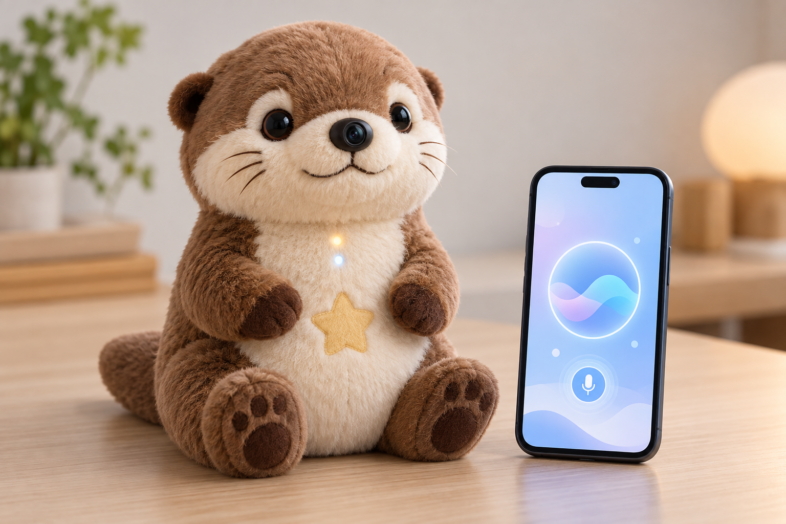
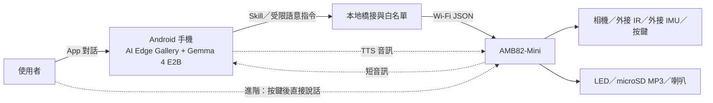

# 星伴水獺 Star Otter

**AMB82-Mini × Android 端 Gemma 4 E2B 的智能陪伴絨毛寵物專題**

> 目前是設計提案。下圖是 AI 合成的成品概念圖，不是實物照片；功能尚待實機驗證。

## 專題亮點

- **抱起來開始故事：** 外接 IMU 偵測玩具被拿起，觸發燈效與故事開場。
- **手機端對話：** Google AI Edge Gallery 在 Android 手機上使用 Gemma 4 E2B 理解問題並產生文字；AMB82-Mini 控制玩具本體。
- **有聲回應：** 第一版播放 microSD 內的問候／故事 MP3；進階版規劃將手機 TTS 音訊傳回玩具。
- **可控的看見功能：** 使用者下指令後才讓相機拍一張，平時不持續錄影。
- **離線退路：** 手機未連線時可按玩具按鍵，播放預錄內容。

## 兩種互動方式

| 方式 | 使用流程 | 專題階段 |
|---|---|---|
| App 互動 | 使用者在手機輸入或說話 → Gemma 4 E2B 產生文字及受限動作 → AMB82 播放／亮燈 | 第一版 |
| 直接對玩具說話 | 按玩具按鍵 → AMB82 收音 → 附近手機橋接、推論及 TTS → 玩具播放 | 進階版，需自製並實測橋接程式 |

Gemma 4 E2B 在**手機**上執行，AMB82-Mini 是硬體控制器。詳細比較含雙輪 RoboCar 的兩種互動方式，請見 [PROPOSAL.md](PROPOSAL.md)。

## 系統架構

### 角色分工

| 模組 | 任務 |
|---|---|
| Android + Gemma 4 E2B | 文字、圖片、短音訊理解；產生故事與回覆文字 |
| AI Edge Gallery Skill／橋接 | 將模型意圖限縮為 `status`、`set_expression`、`play_clip` 等可驗證指令 |
| AMB82-Mini | 感測、相機單次取像、MP3 播放、LED 及裝置端限制 |
| 外接元件 | IR、IMU、按鍵、喇叭與必要音訊電路 |

## 互動示例

1. 使用者抱起星伴水獺，IMU 產生 `picked_up` 事件，玩具亮起暖色燈。
2. 玩具播放 microSD 的「今天想聽什麼故事？」開場音。
3. 使用者在手機 App 說「一個去看星星的水獺故事」。
4. Gemma 4 E2B 生成短故事文字；第一版由手機顯示文字，玩具配合播放一段預錄音效。進階版才將 TTS 語音送到玩具喇叭。

## 第一版交付與驗收

- AMB82-Mini 的按鍵、LED、microSD MP3 播放可運作。
- App 可用 Gemma 4 E2B 產生短故事文字，並透過受限指令控制一項玩具回應。
- IMU 拿起事件可觸發故事開場；斷線時可退回預錄內容。
- 拍照與音訊只在使用者主動操作時啟動；顯示明確狀態燈。

各步驟、硬體清單、API 草案與測試方法見 [PROPOSAL.md](PROPOSAL.md)。

## 專題狀態

這份儲存庫目前提供提案和概念圖，尚未包含經實機驗證的韌體或 Android 橋接程式。Fork 原有的 `GiraffeAgent.ino`、`Architecture.md`、`SKILL.md` 與 `scripts/` 仍是長頸鹿範例資料，**不是星伴水獺已完成的程式**。概念圖透過 AI 圖像生成製作，僅用於說明外觀；相機、電路、供電與喇叭實際位置會在原型階段依測試調整。

## 參考

- [老師範例：AI-plush-giraffe](https://github.com/rkuo2000/AI-plush-giraffe)
- [Gemma 4 模型資料](https://ai.google.dev/gemma/docs/core/model_card_4)
- [Google AI Edge Gallery Skills 文件](https://github.com/google-ai-edge/gallery/blob/main/skills/README.md)
- [AMB82-Mini 官方文件](https://github.com/Ameba-AIoT/ameba-arduino-doc)
